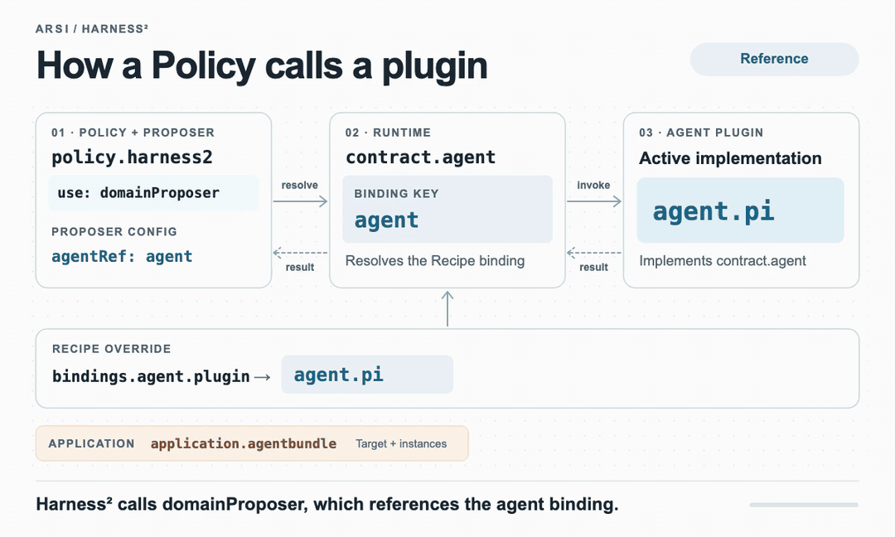

<h1 align="center">
  
</h1>

<h3 align="center">多种自演进策略，一个框架统一承载 · Make Everything RSI-able.</h3>

<p align="center">
  从 Agent Harness 到 AI 基础设施，用同一套框架生成候选方案、评测效果并持续迭代。
</p>

<p align="center">
  
  
  
</p>

<p align="center">
  <a href="./README.md">English</a> | 中文
</p>

<p align="center">
  <a href="#when-to-use">何时使用</a> ·
  <a href="#experiment-results">实验效果</a> ·
  <a href="#overview">简介</a> ·
  <a href="#architecture">工作原理</a> ·
  <a href="#extensions">一切皆插件</a> ·
  <a href="#installation">安装与部署</a> ·
  <a href="#usage">使用 arsi</a> ·
  <a href="#built-in-rsi-strategies">内置 RSI 策略</a> ·
  <a href="#user-guide">使用指南</a>
</p>

<a id="when-to-use"></a>

## 🎯 何时使用 arsi

当你想借助 AI 持续改进 Agent、模型或 AI 基础设施时，`arsi` 的内置策略、可扩展的插件体系和配套 Skill 能帮你快速开展 Agent Skill 优化、推理引擎调优等实验。

| 典型场景                                     | 环境与接入准备                                                                                                                                                    | 可以这样告诉 AI                                                                                                                                                                          |
| -------------------------------------------- | ----------------------------------------------------------------------------------------------------------------------------------------------------------------- | ---------------------------------------------------------------------------------------------------------------------------------------------------------------------------------------- |
| **让 Harness 的 Skill 根据任务反馈自我进化** | 准备可运行的 Harness、任务和评测标准，复用或编写[运行与评测插件](docs/users/guides/writing-plugins_zh.md)。                                                       | “用 arsi 改进这个 Harness 的 Skill，只允许修改 Skill 文件，在我给定的任务和预算内迭代，并用新任务复测效果。”                                                                        |
| **自动搜索更适合当前需求的配置参数**         | 提供参数范围、优化指标与约束，接入配置应用和效果评测插件。                                                                                                        | “用 arsi 在给定范围和预算内自动调整这份配置，满足约束后优化目标指标，交付本次实验表现最好的配置和对比结果。”                                                                        |
| **持续演进算子，寻找正确且延迟更低的实现**   | 准备算子源码与测试环境，接入评测插件，并扩展生成插件和 Policy 以调用 [Memory](docs/users/guides/memory_zh.md)、[Reflection](docs/users/guides/reflection_zh.md)。 | “用 arsi 迭代这份算子：用 Memory 总结有效优化和失败经验，用 Reflection 改进算子生成 Agent 的提示词与指导，供后续轮次使用；在预算内检查正确性、比较延迟，最后独立复测并与基线比较。” |

<a id="experiment-results"></a>

## 📊 实验效果

- Harness 优化实验的内部 Agent 调用由 Pi 执行，使用 `deepseek-v4.1-flash-1017`。「优化目标」列标明被测 DeepSeek Harness（DSH）所用的模型版本，「方法」列记录各基准子集的训练、测试与验证任务数。
- Infra 优化实验的内部 Agent 调用由 Codex 执行，使用 `GPT-6.1 Sol`。推理实验在 [vLLM](https://github.com/vllm-project/vllm) 上运行 `deepseek-v4-flash-0731`，使用 [AISBench](https://github.com/AISBench/benchmark) 评测，输入 4096 个 token，输出 2048 个 token，并发数为 330。算子典型数据集覆盖 `bias-gelu-tanh`、`bias-gelu`、`transpose-copy`、`bias-tanh-gate` 和 `transposed-bias-add`，算子评测检查正确性，并记录设备上的平均执行耗时，性能得分的计算公式为 `基线耗时/ 优化后耗时`。<a id="operator-dataset"></a>
- 表中分数按「基线 → 选定方案」展示，选定方案得分取基线与候选方案两者中的最高分。算子和推理实验的分数均以基线为 100.0% 进行归一化。红色徽章表示提升，灰色表示持平，变化量以百分点（pp）计。

<table>
  <thead>
    <tr>
      <th>优化类型</th>
      <th>基准</th>
      <th>优化目标</th>
      <th>方法</th>
      <th>基准分数</th>
    </tr>
  </thead>
  <tbody>
    <tr>
      <th rowspan="9" scope="rowgroup">Harness 优化</th>
      <th rowspan="3"><a href="https://github.com/Tencent/workbuddy-bench#overview">WorkBuddy Bench</a><br>代码子集</th>
      <td rowspan="3" align="center"><a href="https://github.com/deepseek-ai/deepseek-harness">DSH</a> +<br><code>deepseek-v4.1-flash-1017</code></td>
      <td><a href="https://arxiv.org/abs/2608.27454">WikiSkill</a><br><sub>训练 10 个任务 / 验证 5 个任务</sub></td>
      <td align="center">92.9% → 96.0% </td>
    </tr>
    <tr>
      <td><a href="https://github.com/google-research/harness2">Harness²</a><br><sub>验证 10 个任务</sub></td>
      <td align="center">78.5% → 78.5% </td>
    </tr>
    <tr>
      <td><a href="https://arxiv.org/abs/2507.19457">GEPA</a><br><sub>训练 10 个任务 / 验证 5 个任务</sub></td>
      <td align="center">94.5% → 94.5% </td>
    </tr>
    <tr>
      <th rowspan="3"><a href="https://github.com/Tencent/workbuddy-bench#overview">WorkBuddy Bench</a><br>办公子集</th>
      <td rowspan="3" align="center"><a href="https://github.com/deepseek-ai/deepseek-harness">DSH</a> +<br><code>deepseek-v4.1-flash-1017</code></td>
      <td><a href="https://arxiv.org/abs/2608.27454">WikiSkill</a><br><sub>训练 16 个任务 / 测试 4 个任务 / 验证 10 个任务</sub></td>
      <td align="center">87.4% → 89.5% </td>
    </tr>
    <tr>
      <td><a href="https://github.com/google-research/harness2">Harness²</a><br><sub>验证 30 个任务</sub></td>
      <td align="center">83.2% → 83.2% </td>
    </tr>
    <tr>
      <td><a href="https://arxiv.org/abs/2507.19457">GEPA</a><br><sub>训练 16 个任务 / 测试 4 个任务 / 验证 10 个任务</sub></td>
      <td align="center">84.2% → 92.6% </td>
    </tr>
    <tr>
      <th rowspan="3"><a href="https://www.tbench.ai/news/terminal-bench-4-0">Terminal-Bench 4.0</a></th>
      <td rowspan="3" align="center"><a href="https://github.com/deepseek-ai/deepseek-harness">DSH</a> +<br><code>deepseek-v4.1-flash-1017</code></td>
      <td><a href="https://arxiv.org/abs/2608.27454">WikiSkill</a><br><sub>训练 10 个任务 / 测试 10 个任务 / 验证 5 个任务</sub></td>
      <td align="center">20.0% → 40.0% </td>
    </tr>
    <tr>
      <td><a href="https://github.com/google-research/harness2">Harness²</a><br><sub>验证 25 个任务</sub></td>
      <td align="center">12.0% → 28.0% </td>
    </tr>
    <tr>
      <td><a href="https://arxiv.org/abs/2507.19457">GEPA</a><br><sub>训练 16 个任务 / 测试 4 个任务 / 验证 10 个任务</sub></td>
      <td align="center">50.0% → 50.0% </td>
    </tr>
  </tbody>
  <tbody>
    <tr>
      <th rowspan="3" scope="rowgroup">Infra 优化</th>
      <th rowspan="2"><a href="#operator-dataset">算子典型数据集</a></th>
      <td rowspan="2" align="center"><a href="https://github.com/triton-lang/triton">Triton kernel</a></td>
      <td><a href="src/policies/operator-search/policy.yaml"><code>operator-search</code></a><br><sub>关闭 Reflection</sub></td>
      <td align="center">100.0% → 111.0% </td>
    </tr>
    <tr>
      <td><a href="src/policies/operator-search/policy.yaml"><code>operator-search</code></a><br><sub>开启 Reflection</sub></td>
      <td align="center">100.0% → 113.2% </td>
    </tr>
    <tr>
      <th><a href="https://github.com/AISBench/benchmark">AISBench</a></th>
      <td align="center"><a href="https://github.com/vllm-project/vllm">vLLM</a> +<br><code>deepseek-v4-flash-0731</code></td>
      <td><a href="src/policies/parameter/agent/policy.yaml"><code>parameter-agent</code></a><br><sub>开启 Reflection 和 Memory</sub></td>
      <td align="center">100.0% → 171.0% </td>
    </tr>
  </tbody>
</table>

<a id="overview"></a>

## ℹ️ 简介

`arsi` 是面向 Agent 和 AI 基础设施的插件化递归自改进（RSI）实验框架。


- **由 Recipe 驱动自演进**。声明式 Recipe（`recipe.yaml`）连接优化目标（Application）、策略（Policy）和评测器（Evaluator）。每次实验都有明确的修改范围和固定预算。
- **内置策略与扩展能力**。框架内置 Harness²、WikiSkill、GEPA 等 Agent Harness 优化策略，以及推理参数搜索和算子优化策略。为其他目标定义允许的修改、生成候选方案并衡量效果，即可将其接入同一框架。
- **面向开发者和编程 Agent**。开发者可通过 CLI 配置和运行实验，并在网页中查看结果。编程 Agent 可通过 RSI Skill 使用同一套工具。我们希望它们能在开发者授权的范围和预算内规划、校验、运行实验，诊断失败，并根据评测结果决定下一步。

<a id="architecture"></a>

## 🔄 工作原理

### 架构总览


1. **定义优化目标。** 在 Recipe 中选择 Application，指定基线和允许修改的范围。Application 还决定如何把候选版本实例化，供 Evaluator 评测。
2. **运行优化循环。** Runtime 按 Policy 执行。Application 初始化基线，校验并提交 Proposer 提出的改动，并为 Evaluator 提供和释放实例。Selector 根据评测结果或交付物选择下一轮的起点。
3. **让组件自进化。** Policy 可调用 Memory 沉淀实验经验，也可调用 Reflection 根据执行证据改进组件的提示词、资源或配置。

<a id="extensions"></a>

### 一切皆插件



_Harness² 示例 · Proposer 通过 `agent` 引用绑定。在 Recipe 中修改绑定后，下一次运行时同一个调用就会从 `agent.pi` 切换到 `agent.codex`。_

- **Application（优化目标与实例化）** 是 Recipe 在 `application` 下选择的核心插件。它定义优化什么、允许改动什么，以及如何为评测准备和释放候选实例。内置实现可管理 AgentBundle、推理服务配置或 Triton-Ascend 算子。
- **Policy（优化策略）** 定义 RSI 循环、停止条件，以及各插件绑定所需的契约。
- **Plugin（插件）** 实现一个契约。契约规定输入和输出，满足同一契约的实现可以替换。
- **Recipe（实验配方）** 选择 Application 和 Policy，为流程绑定具体插件，并提供配置和预算。
- [选择 Application](docs/users/guides/built-in-components_zh.md#application)
- [编写 Policy](docs/users/guides/writing-policies_zh.md)
- [编写插件](docs/users/guides/writing-plugins_zh.md)
- [用 Recipe 组装实验](docs/users/guides/configuration_zh.md#recipe-字段与绑定覆盖)

<a id="installation"></a>

## 📦 安装与部署

### 编程 Agent 安装指令

将下面这段指令复制给你的编程 Agent：

```text
请从 https://github.com/ARSI-LAB/ARSI 安装 arsi CLI 和配套 skill。
按照 README 中的 CLI 手动安装说明，检查前置依赖、克隆仓库、安装依赖、构建并安装 CLI。
将完整的 skills/arsi 目录（包括引用资料和模板）复制到当前 Agent 支持的 skill 目录，替换同名 skill 前先询问。
运行 arsi --help，并确认当前 Agent 能发现和读取该 skill。本次只完成安装，不启动实验或调用模型。
```

### 手动安装

#### 1. 安装 CLI

环境要求

1. **Node.js** >= 24.19.0 且 < 25。
2. **pnpm** 11.22.0。
3. **Git**，用于拉取 AgentBundle 和 Evaluator SDK 依赖。

```sh
# 克隆并构建 arsi。
git clone git@github.com:ARSI-LAB/ARSI.git
cd ARSI
pnpm install --frozen-lockfile
pnpm build
pnpm add -g .

# 检查安装后的 CLI 是否可用。
arsi --help
```

#### 2. 安装 skill

在目标项目目录执行以下命令，并选择要安装到的编程 Agent：

```sh
npx skills add ARSI-LAB/ARSI --skill arsi
```

如需用户级安装，添加 `-g`。按 Agent 的要求重新加载或重启，然后确认能发现和读取 `arsi` skill。

将 RSI Skill 加载到支持 Skill 的编程助手后，可以直接交代优化目标、允许修改的范围和预算，让助手选择或编写 Recipe、校验配置，并在授权后运行实验、检查结果和诊断失败。

- **RSI Skill** 的入口是 [SKILL.md](skills/arsi/SKILL.md)。加载时请保留整个 `skills/arsi/` 目录，以便助手访问参考文档和模板。可先用[最小示例](skills/arsi/references/quickstart.md)验证配方和插件能否正常协作。

后续命令均在 `arsi` 仓库根目录执行，使用已安装的 `arsi` CLI。

<a id="usage"></a>

## 🛠️ 使用 arsi

### 快速开始

#### 1. 配置模型与评测环境

下面以 [Harness² 示例](examples/harness/dsh-harness2/README.md)（WorkBuddy Office 场景）为例。请先按 Evaluator 的 [WorkBuddy 配置说明](https://github.com/ARSI-LAB/ARSI-Evaluator/blob/master/docs/users/benchmarks/workbuddy.zh-CN.md) 准备 **Docker**、题库与容器镜像，并确保宿主机与评测容器均可访问模型服务地址。

```bash
# 在运行 arsi 的同一个终端中显式设置变量，arsi 不会自动读取 .env 文件。

# 优化器模型，用于生成候选修改。
export MODEL_NAME="your-optimizer-model"

# 被测 Agent 使用的模型，无固定默认值。
# 请填写模型服务支持的模型名称。
export EVALUATOR_MODEL_NAME="your-evaluation-model"

# 优化器和评测模型默认共用的服务地址与 API 密钥。
export MODEL_ENDPOINT="https://your-model-service.example/v1"
export MODEL_API_KEY="your-api-key"
```

#### 2. 校验、运行与续跑实验

Harness² 默认在 10 个任务上优化 AgentBundle 基线（最多 40 次评测、72 小时实验总时限）。首次试跑可先在 [recipe.yaml](examples/harness/dsh-harness2/recipe.yaml) 的 `policy.config.dataset.taskIds` 中只保留第一道题：

```sh
# 校验实验配方，不启动实验。
arsi doctor examples/harness/dsh-harness2/recipe.yaml

# 以 my-harness2-task 为实验 ID 启动实验，会发起真实模型调用。
arsi run examples/harness/dsh-harness2/recipe.yaml --id my-harness2-task
```

- 候选版本、评测指标、调用收据与证据默认保存在当前目录的 `.rsi/` 下，请结合评测状态、得分和交付物判断实验结果。
- 详细用法见 `docs/users` 下的 [快速入门](docs/users/getting-started_zh.md)、[Reflection 指南](docs/users/guides/reflection_zh.md) 和 [运行时事件说明](docs/users/guides/runtime-events_zh.md)。

若实验中断，可在原工作目录使用相同的 Recipe 和实验 ID 断点续跑。

```sh
# 从已保存的检查点续跑。
arsi run examples/harness/dsh-harness2/recipe.yaml --id my-harness2-task --resume
```

### 查看实验进度

下面两个命令都要在执行 `arsi run` 的同一个目录下运行。它们从该目录下的 `.rsi/` 读取实验数据。

在终端查看实验状态时，把实验 ID 传给 `show`。

```sh
arsi show my-harness2-task
```

也可以启动本地只读 Dashboard，然后在浏览器打开终端显示的地址，查看实验进度。

```sh
arsi dashboard
```

<a id="built-in-rsi-strategies"></a>

## 🧩 内置 RSI 策略

<table>
  <thead>
    <tr>
      <th>优化类型</th>
      <th>Policy</th>
      <th>如何优化目标</th>
      <th>示例 Recipe</th>
      <th>可替换插件</th>
    </tr>
  </thead>
  <tbody>
    <tr>
      <td rowspan="3" align="center"><strong>Harness</strong></td>
      <td><a href="src/policies/harness2/policy.yaml">harness2</a></td>
      <td>进行通用、领域的改进，再进行组合，最后匿名评测比较交付物。</td>
      <td><a href="examples/harness/dsh-harness2/README.md">DSH Harness²</a></td>
      <td>
        <a href="src/plugins/agent-pi"><code>agent.pi</code></a><br>
        <a href="src/plugins/proposer-agent"><code>proposer.agent</code></a><br>
        <a href="src/plugins/evaluator-agentbench"><code>evaluator.agentbench</code></a><br>
        <a href="src/plugins/selector-artifacts"><code>selector.artifact</code></a><br>
        <a href="src/plugins/memory-agent"><code>memory.agent</code></a>
      </td>
    </tr>
    <tr>
      <td><a href="src/policies/wikiskill/policy.yaml">wikiskill</a></td>
      <td>将训练经验汇总到 Wiki，按验证集表现筛选 Skill 修改，搜索结束后独立测试最终方案。</td>
      <td><a href="examples/harness/dsh-wikiskill/README.md">DSH WikiSkill</a></td>
      <td>
        <a href="src/plugins/agent-pi"><code>agent.pi</code></a><br>
        <a href="src/plugins/proposer-agent"><code>proposer.agent</code></a><br>
        <a href="src/plugins/memory-agent"><code>memory.agent</code></a><br>
        <a href="src/plugins/evaluator-agentbench"><code>evaluator.agentbench</code></a><br>
        <a href="src/plugins/selector-metrics"><code>selector.metric</code></a>
      </td>
    </tr>
    <tr>
      <td><a href="src/policies/gepa/policy.yaml">gepa</a></td>
      <td>根据执行反馈生成提示词变异版本，通过 Pareto 前沿采样和种群搜索选择改进方案。</td>
      <td><a href="examples/harness/dsh-gepa/README.md">DSH GEPA</a></td>
      <td>
        <a href="src/plugins/agent-pi"><code>agent.pi</code></a><br>
        <a href="src/plugins/proposer-agent"><code>proposer.agent</code></a><br>
        <a href="src/plugins/proposer-pareto-evolution"><code>proposer.pareto-evolution</code></a><br>
        <a href="src/plugins/evaluator-agentbench"><code>evaluator.agentbench</code></a>
      </td>
    </tr>
    <tr>
      <td rowspan="2" align="center"><strong>推理引擎相关参数</strong></td>
      <td><a href="src/policies/parameter/grid/policy.yaml">parameter-grid</a></td>
      <td>在参数网格中寻找满足延迟 SLO 等约束的最高吞吐配置。</td>
      <td><a href="examples/artifacts/inference/parameter-grid/README.md">推理参数网格搜索</a></td>
      <td>
        <a href="src/plugins/proposer-grid"><code>proposer.grid</code></a><br>
        <a href="src/plugins/evaluator-inferencebench"><code>evaluator.inferencebench</code></a><br>
        <a href="src/plugins/selector-metrics"><code>selector.metric</code></a>
      </td>
    </tr>
    <tr>
      <td><a href="src/policies/parameter/optuna/policy.yaml">parameter-optuna</a></td>
      <td>用 Optuna TPE 或随机采样搜索推理参数。</td>
      <td><a href="examples/artifacts/inference/parameter-tpe/README.md">推理参数 TPE 搜索</a></td>
      <td>
        <a href="src/plugins/proposer-optuna"><code>proposer.optuna</code></a><br>
        <a href="src/plugins/evaluator-inferencebench"><code>evaluator.inferencebench</code></a><br>
        <a href="src/plugins/selector-metrics"><code>selector.metric</code></a>
      </td>
    </tr>
    <tr>
      <td align="center"><strong>算子</strong></td>
      <td><a href="src/policies/operator-search/policy.yaml">operator-search</a></td>
      <td>搜索 Triton-Ascend 算子改进方案，并独立复评选中的候选方案。</td>
      <td><a href="examples/artifacts/kernel/transpose-copy/README.zh-CN.md">Transpose-copy 算子优化</a></td>
      <td>
        <a href="src/plugins/agent-pi"><code>agent.pi</code></a><br>
        <a href="src/plugins/proposer-operator"><code>proposer.operator</code></a><br>
        <a href="src/plugins/evaluator-operatorbench"><code>evaluator.operatorbench</code></a><br>
        <a href="src/plugins/selector-metrics"><code>selector.metric</code></a>
      </td>
    </tr>
  </tbody>
</table>

<a id="user-guide"></a>

## 📖 使用指南

- [快速入门](docs/users/getting-started_zh.md)
- [架构与核心概念](docs/users/concepts/architecture_zh.md)
- [内置组件](docs/users/guides/built-in-components_zh.md)
- [配置实验](docs/users/guides/configuration_zh.md)
- [运行与检查实验](docs/users/guides/running-experiments_zh.md)
- [使用 Skill](docs/users/guides/using-skills_zh.md)
- [Memory 使用指南](docs/users/guides/memory_zh.md)
- [Reflection 使用指南](docs/users/guides/reflection_zh.md)
- [编写 Policy](docs/users/guides/writing-policies_zh.md)
- [编写插件](docs/users/guides/writing-plugins_zh.md)
- [事件系统开发指南](docs/users/guides/runtime-events_zh.md)

## 🙏 致谢

感谢 [Cordis 项目](https://github.com/cordiverse/cordis) 的维护者和贡献者，arsi 使用 Cordis 注册插件、隔离实验上下文和分发运行时事件。
